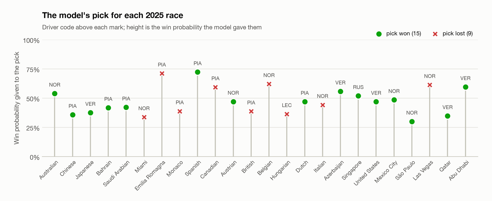
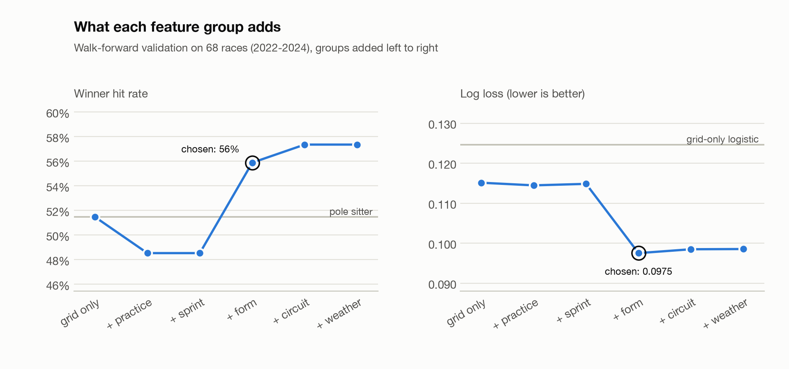
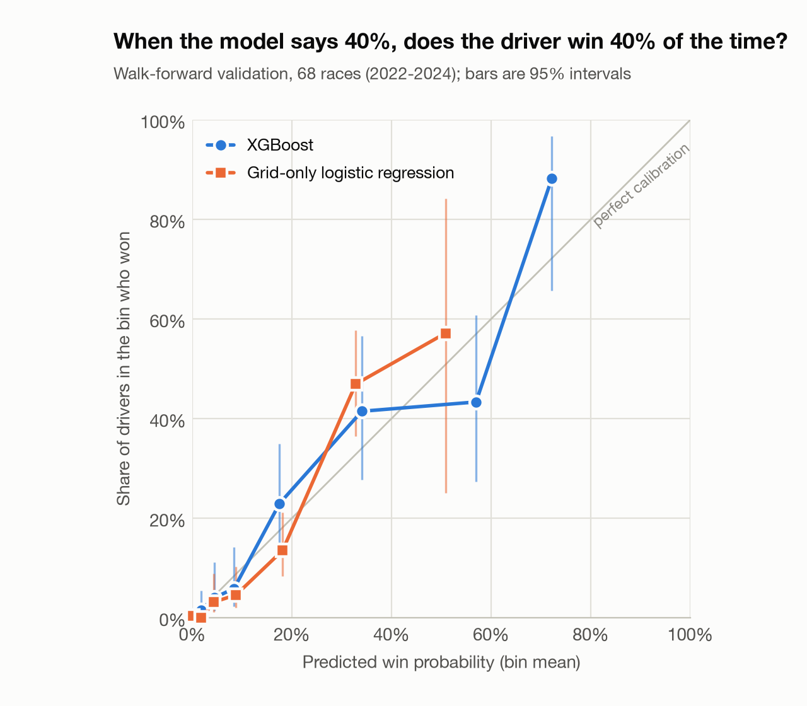
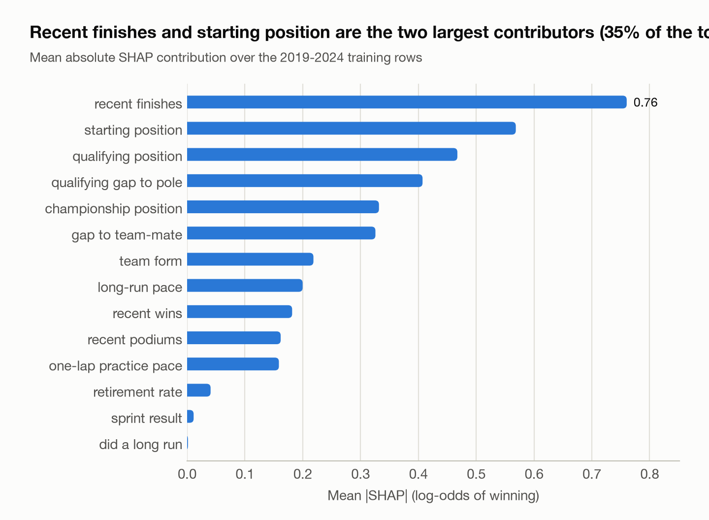

# F1 race winner predictor

<!-- summary:start -->
_Summary is written after the locked 2025 run._
<!-- summary:end -->

**2025 season, 24 races, model frozen before any 2025 result was read**

<!-- results_2025:start -->
_Filled in by `make test-2025`._
<!-- results_2025:end -->

<!-- results_2025_notes:start -->
<!-- results_2025_notes:end -->



## How to run it

```bash
make setup        # virtualenv + pinned requirements (macOS: `brew install libomp` first, for XGBoost)
make data         # download every session into data/raw
make features     # build data/processed/features.parquet
make test-2025    # the locked 2025 run
```

`make data` is the slow step the first time: about 760 sessions, and both data
sources throttle (see [Data](#data-and-features)). After that every session is
served from `data/cache` and a rebuild takes a few minutes with no network.
`make test-2025` only runs at the `v1.0` tag and only once; in this repository
it has already been run, so use `make report` to rebuild the tables and figures
from the saved predictions, or check out `v1.0` in a clean clone to reproduce
the run itself.

Everything else:

```bash
make test         # leakage tests (synthetic + real data) and pipeline tests
make eda          # execute notebooks/01_eda.ipynb (2019-2024 only)
make cv           # walk-forward validation, ablation, tuning, recency test
make freeze       # write the chosen setup to config/model.json
make app          # Streamlit demo of the 2025 predictions
python -m f1pred.predict 2026 18    # score an upcoming race after qualifying
```

## Data and features

[FastF1](https://docs.fastf1.dev) 3.8.3 supplies results, lap-by-lap practice
timing and weather. `f1pred.ingest` flattens four session types into six
parquet tables per season; nothing after that stage calls the API.

| Season | Races | Sprint weekends | Role |
| --- | --- | --- | --- |
| 2019 | 21 | 0 | train |
| 2020 | 17 | 0 | train |
| 2021 | 22 | 3 | train |
| 2022 | 22 | 3 | train, validation fold 1 |
| 2023 | 22 | 6 | train, validation fold 2 |
| 2024 | 24 | 6 | train, validation fold 3 |
| 2025 | 24 | 6 | locked test |

152 races, 3,038 driver-race rows, target `won = (Position == 1)`.

The feature table has one row per driver per race and 19 features. Every one
can be computed on Saturday night.

| Group | Features | Source |
| --- | --- | --- |
| Grid | `grid_pos` (pit lane = 21), `quali_pos`, `quali_gap_pct` (best Q time vs pole), `teammate_quali_delta` | starting grid, qualifying |
| Practice | `longrun_gap_pct` (median lap of 5+ lap runs vs best driver on the same compound), `shortrun_gap_pct` (best lap vs session best), `has_longrun` | practice laps, green-flag accurate laps only |
| Sprint | `sprint_pos` (empty on normal weekends) | sprint results |
| Form | `drv_avg_finish_5`, `drv_wins_5`, `drv_podiums_5`, `team_points_5`, `champ_rank`, `dnf_rate_10` | earlier races |
| Circuit | `drv_track_avg_finish`, `track_pole_win_rate`, `street_circuit` | earlier visits, hand label |
| Weather | `quali_rain`, `fp_track_temp` | session weather |

Things in the data that needed handling:

- **Sprint weekends change the session order** three times in seven seasons, so
  sessions are read from each weekend's schedule. Long runs come from FP2 and
  fall back to FP1 when a weekend has no FP2 long runs.
- **Missing practice is normal, not an error.** A driver with no long run gets
  an empty `longrun_gap_pct` (XGBoost handles missing values natively) and
  `has_longrun = 0`. A long-run gap only counts when at least three drivers ran
  that compound.
- **Pit-lane starts** arrive as grid position 0 through 2024 and are mapped to
  21. From 2025 the results API numbers them at the back of the grid instead.
- **DNFs still get a `Position`**, so classification comes from
  `ClassifiedPosition` (a letter means not classified).
- **Teams and venues are renamed.** Toro Rosso, AlphaTauri and RB are one
  lineage, as are Racing Point/Aston Martin, Renault/Alpine and Alfa
  Romeo/Sauber; "Monte Carlo"/"Monaco" and "Miami"/"Miami Gardens" are one circuit.
- **Two throttles.** The results API refuses more than about one request every
  two seconds, and FastF1 caps a process at 500 requests an hour. Ingestion
  fetches results one at a time, waits when the cap trips, and re-requests a
  results table that comes back empty instead of saving it.

## Validation design

**The lights-out rule.** A feature may use practice, qualifying, the sprint, the
starting grid and anything from earlier races. Nothing from the race itself.
[`tests/test_leakage.py`](tests/test_leakage.py) enforces it with two properties,
checked on a synthetic championship in CI and on the real tables locally:

1. *No future data.* Features built from all 152 races equal features built
   from only the races up to a target race.
2. *No same-race data.* Shuffling the target race's finishing order leaves its
   features unchanged (and does change later races' features, so the test is not vacuous).

Two further tests swap in a deliberately leaky rolling mean and confirm both
properties fail. Rolling windows are always shifted by one race first.

**Walk-forward folds.** Each fold trains on the past and predicts the next
season, exactly as the model would be used.

| Fold | Train on | Predict | Races |
| --- | --- | --- | --- |
| 1 | 2019–2021 | 2022 | 22 |
| 2 | 2019–2022 | 2023 | 22 |
| 3 | 2019–2023 | 2024 | 24 |
| Final test | 2019–2024 | 2025, once | 24 |

**Selection rules, written into `train.py` before any validation run:**
feature groups are added one at a time and the step with the lowest pooled log
loss is kept; a 54-combination grid is chosen by pooled log loss; recency
weighting is kept only if pooled log loss and at least two of three folds
improve; every model is the average of five seeds. No `scale_pos_weight`.

**The 2025 lock.** `walk_forward` raises on any frame containing 2025.
`make test-2025` refuses to run unless `config/` and `src/f1pred/` match the
`v1.0` tag exactly, and refuses to run twice.

<!-- lock_statement:start -->
<!-- lock_statement:end -->

## Results

### Validation, 68 races (2022–2024)

<!-- validation:start -->
| Model | Winner hit rate | 95% CI | vs pole sitter (95% CI) | Top-3 hit rate | Hits in the 33 races pole lost | Log loss | Brier |
| --- | --- | --- | --- | --- | --- | --- | --- |
| XGBoost | 57.4% (39 of 68) | 45.6% to 69.1% | +5.9% (-4.4% to +16.2%) | 88.2% (79.4% to 95.6%) | 9 of 33 | 0.0964 | 0.0290 |
| Pole sitter | 51.5% (35 of 68) | 39.7% to 63.2% | baseline | 83.8% (75.0% to 92.6%) | 0 of 33 | n/a | n/a |
| Form leader | 51.5% (35 of 68) | 39.7% to 63.2% | +0.0% (-16.2% to +16.2%) | 70.6% (60.3% to 80.9%) | 16 of 33 | n/a | n/a |
| Grid-only logistic regression | 50.0% (34 of 68) | 38.2% to 61.8% | -1.5% (-4.4% to +0.0%) | 85.3% (76.5% to 92.6%) | 0 of 33 | 0.1247 | 0.0346 |
<!-- validation:end -->

<!-- validation_notes:start -->
Frozen setup: 14 features, {'max_depth': 2, 'learning_rate': 0.03, 'n_estimators': 400, 'min_child_weight': 5}, recency weighting off, 5 seeds averaged.

Log loss against the grid-only logistic regression: -0.0283 (-22.7%; 95% CI -0.0464 to -0.0121). Expected calibration error: XGBoost 0.013, logistic regression 0.020.
<!-- validation_notes:end -->

<details>
<summary>Per fold</summary>

<!-- validation_folds:start -->
| Model | Fold | Races | Winner hit rate | Top-3 hit rate | Hit rate when pole lost | Log loss | Brier |
| --- | --- | --- | --- | --- | --- | --- | --- |
| XGBoost | 2022 | 22 | 40.9% | 90.9% | 8.3% | 0.1092 | 0.0351 |
| XGBoost | 2023 | 22 | 81.8% | 100.0% | 62.5% | 0.0579 | 0.0153 |
| XGBoost | 2024 | 24 | 50.0% | 75.0% | 23.1% | 0.1199 | 0.0359 |
| XGBoost | pooled | 68 | 57.4% | 88.2% | 27.3% | 0.0964 | 0.0290 |
| Pole sitter | 2022 | 22 | 45.5% | 81.8% | 0.0% | n/a | n/a |
| Pole sitter | 2023 | 22 | 63.6% | 86.4% | 0.0% | n/a | n/a |
| Pole sitter | 2024 | 24 | 45.8% | 83.3% | 0.0% | n/a | n/a |
| Pole sitter | pooled | 68 | 51.5% | 83.8% | 0.0% | n/a | n/a |
| Form leader | 2022 | 22 | 50.0% | 63.6% | 50.0% | n/a | n/a |
| Form leader | 2023 | 22 | 86.4% | 95.5% | 87.5% | n/a | n/a |
| Form leader | 2024 | 24 | 20.8% | 54.2% | 23.1% | n/a | n/a |
| Form leader | pooled | 68 | 51.5% | 70.6% | 48.5% | n/a | n/a |
| Grid-only logistic regression | 2022 | 22 | 40.9% | 81.8% | 0.0% | 0.1293 | 0.0371 |
| Grid-only logistic regression | 2023 | 22 | 63.6% | 90.9% | 0.0% | 0.1063 | 0.0311 |
| Grid-only logistic regression | 2024 | 24 | 45.8% | 83.3% | 0.0% | 0.1373 | 0.0356 |
| Grid-only logistic regression | pooled | 68 | 50.0% | 85.3% | 0.0% | 0.1247 | 0.0346 |
<!-- validation_folds:end -->

</details>

### Ablation: what each feature group adds

<!-- ablation:start -->
| Features | Count | Winner hit rate | Top-3 hit rate | Log loss | Brier |
| --- | --- | --- | --- | --- | --- |
| grid only | 4 | 51.5% | 85.3% | 0.1151 | 0.0349 |
| + practice | 7 | 48.5% | 85.3% | 0.1145 | 0.0345 |
| + sprint | 8 | 48.5% | 85.3% | 0.1148 | 0.0346 |
| **+ form** (chosen) | 14 | 55.9% | 88.2% | 0.0975 | 0.0294 |
| + circuit | 17 | 57.4% | 88.2% | 0.0985 | 0.0296 |
| + weather | 19 | 57.4% | 86.8% | 0.0986 | 0.0294 |
<!-- ablation:end -->



Recency weighting (`0.7 ** seasons back`):

<!-- recency:start -->
| Sample weighting | Winner hit rate | Log loss | Log loss 2022 | Log loss 2023 | Log loss 2024 |
| --- | --- | --- | --- | --- | --- |
| equal | 57.4% | 0.0964 | 0.1092 | 0.0579 | 0.1199 |
| 0.7 ** seasons back | 52.9% | 0.0977 | 0.1095 | 0.0545 | 0.1267 |
<!-- recency:end -->

### Calibration



### What the model relies on



### 2025, race by race

<!-- per_race_2025:start -->
<!-- per_race_2025:end -->

<!-- miss_causes:start -->
<!-- miss_causes:end -->

<!-- error_analysis:start -->
<!-- error_analysis:end -->

## Limitations and next steps

<!-- limitations:start -->
<!-- limitations:end -->

## Repository layout

```
src/f1pred/
  ingest.py      download sessions, save raw tables
  features.py    build the driver-race feature table
  baselines.py   pole sitter, form leader, grid-only logistic regression
  train.py       walk-forward validation, tuning, freeze
  evaluate.py    metrics tables, figures, the locked 2025 run
  predict.py     score an upcoming race
  metrics.py, plots.py, eda.py, config.py
notebooks/       01_eda.ipynb, 02_results.ipynb (display only; the scripts do the work)
tests/           test_leakage.py, test_pipeline.py, synthetic.py
config/model.json   the frozen features and parameters
reports/         validation and 2025 outputs, figures
models/          the five fitted boosters from the 2025 run
app.py           Streamlit demo
```
