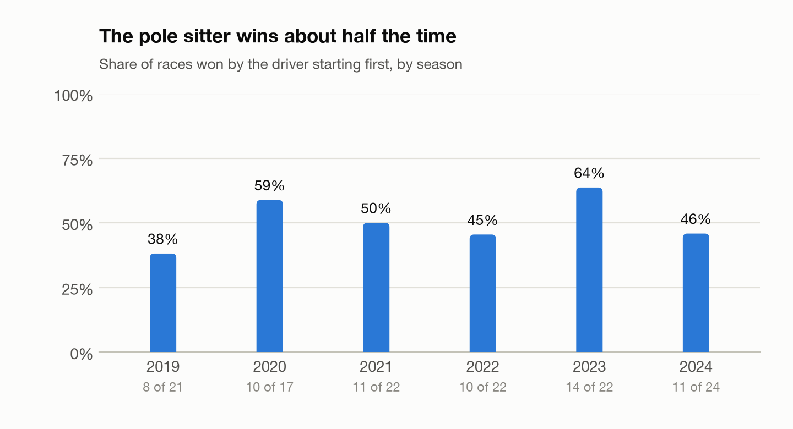

# F1 race winner predictor

[](https://github.com/codyk2/f1-winner-predictor/actions/workflows/tests.yml)

A pre-race win-probability model for Formula 1. Before each Grand Prix it gives
every driver a chance of winning, using only what is known at lights out:
practice, qualifying, the sprint, the starting grid and earlier races. It was
trained on 2019–2024 and judged once on the 24 races of 2025 against the
simplest rival: "the pole sitter wins."

**It did not beat that rule on picks.** The model picked the winner in 15 of 24
races; the pole sitter won 16. One race is 4 percentage points and the 95%
interval on the difference runs from −21 to +13 points, so the two cannot be
told apart on one season, and 2025 was a pole-dominated one (67% from pole,
against 50% over 2019–2024). What the model adds is in the probabilities: its
log loss was 9% lower than a grid-only logistic regression on 2025 (inside the
noise on 24 races) and 23% lower on the 68 validation races (clear of it). It
called 2 of the 8 races the pole sitter lost, and the winner was in its top
three in all 24 races, against 23 for the first three on the grid.

A second check, run after the fact on the first 17 races of 2026 with nothing
re-tuned, went 13 of 17 against 12 for the pole sitter.
[Details and caveats below.](#2026-so-far-a-second-look-after-the-fact)

Then came [three passes at a better model](#version-2-improving-the-model-after-the-test).
Version 2.0 rebuilds the long-run practice feature, adds two qualifying
features and constrains the trees to be monotone. It beats v1.0 on the four
development seasons (56 winners of 92 against 54, log loss 6% lower) and does
not beat it on 2026 (12 of 17 against 13, log loss equal).
Both models are now scored side by side on every race still to come.

**2025 season, 24 races. The model was frozen and tagged `v1.0` before this was run, once.**

<!-- results_2025:start -->
| Model | Picked the winner | 95% CI | vs pole sitter (95% CI) | Winner in top 3 | Hits when pole lost | Log loss | Brier |
| --- | --- | --- | --- | --- | --- | --- | --- |
| XGBoost | 15 of 24 (62.5%) | 42.7% to 78.8% | -4.2% (-20.8% to +12.5%) | 24 of 24 (86.2% to 100.0%) | 2 of 8 | 0.0895 | 0.0285 |
| Pole sitter | 16 of 24 (66.7%) | 46.7% to 82.0% | baseline | 23 of 24 (79.8% to 99.3%) | 0 of 8 | n/a | n/a |
| Form leader | 7 of 24 (29.2%) | 14.9% to 49.2% | -37.5% (-62.5% to -8.3%) | 17 of 24 (50.8% to 85.1%) | 3 of 8 | n/a | n/a |
| Grid-only logistic regression | 16 of 24 (66.7%) | 46.7% to 82.0% | same hits and misses | 23 of 24 (79.8% to 99.3%) | 0 of 8 | 0.0985 | 0.0299 |
<!-- results_2025:end -->

<!-- results_2025_notes:start -->
Log loss against the grid-only logistic regression: -0.0090 (-9.2%; 95% CI -0.0221 to +0.0053). The single most favourable race (round 6 of 2025) supplies 32% of that gap; without it the gap is -6.7%. Expected calibration error on 2025: 0.022. Rates carry Wilson intervals; differences are paired bootstraps over the 24 races (exact for hits, 10,000 resamples for log loss). One race is about 4%.
<!-- results_2025_notes:end -->


## How to run it

```bash
make setup        # virtualenv + pinned requirements (macOS: `brew install libomp` first, for XGBoost)
make data         # download every session into data/raw
make features     # build data/processed/features.parquet
make test-2025    # the locked 2025 run
```

`make data` is the slow step the first time: about 750 sessions, and both data
sources throttle (see [Data](#data-and-features)), so expect one to two hours,
most of it waiting. After that every session is served from `data/cache` and a
rebuild takes about two minutes.

`make test-2025` only runs at the `v1.0` tag and only once; in this repository
it has already been run, so use `make report` to rebuild the tables and figures
from the saved predictions, or check out `v1.0` in a clean clone to reproduce
the run itself.

Everything else:

```bash
make test         # leakage tests (synthetic + real data) and pipeline tests
make eda          # execute notebooks/01_eda.ipynb (2019-2024 only)
make cv           # walk-forward validation, ablation, tuning, recency test
make freeze       # write the chosen setup to config/model.json
make app          # Streamlit demo of the 2025 predictions
make history      # 2014-2018 results, used by some version 2 experiments
make v2           # version 2: features, every experiment, the log table
python -m f1pred.predict 2026 18    # score an upcoming race after qualifying (v2.0 and v1.0)
```

## Data and features

[FastF1](https://docs.fastf1.dev) 3.8.3 supplies results, lap-by-lap practice
timing and weather. `f1pred.ingest` flattens four session types into six
parquet tables per season; nothing after that stage calls the API.

| Season | Races | Sprint weekends | Role |
| --- | --- | --- | --- |
| 2019 | 21 | 0 | train |
| 2020 | 17 | 0 | train |
| 2021 | 22 | 3 | train |
| 2022 | 22 | 3 | train, validation fold 1 |
| 2023 | 22 | 6 | train, validation fold 2 |
| 2024 | 24 | 6 | train, validation fold 3 |
| 2025 | 24 | 6 | locked test |

152 races, 3,038 driver-race rows, target `won = (Position == 1)`. Every race
has exactly one winner and 20 entries, except two with 19. Five practice
sessions were cancelled for weather and are simply absent.



The pole sitter won 64 of the 128 races in 2019–2024, anywhere from 38% to 64%
of a season, which is why every result here sits next to the pole-sitter
baseline on the same races. The six EDA questions and their answers are in
[`notebooks/01_eda.ipynb`](notebooks/01_eda.ipynb).

The feature table has one row per driver per race and 19 features. Every one
is known before lights out; all but the final starting grid are known on
Saturday night (`predict.py` uses qualifying order until the grid is published).
The frozen model uses the first four groups (14 features); the
[ablation](#ablation-what-each-feature-group-adds) shows why.

| Group | Features | Source |
| --- | --- | --- |
| Grid | `grid_pos` (pit lane = 21), `quali_pos`, `quali_gap_pct` (best Q time vs the fastest time of the session), `teammate_quali_delta` | starting grid, qualifying |
| Practice | `longrun_gap_pct` (median lap of 5+ lap runs vs best driver on the same compound), `shortrun_gap_pct` (best lap vs session best), `has_longrun` | practice laps, green-flag accurate laps only |
| Sprint | `sprint_pos` (empty on normal weekends) | sprint results |
| Form | `drv_avg_finish_5`, `drv_wins_5`, `drv_podiums_5`, `team_points_5`, `champ_rank`, `dnf_rate_10` | earlier races |
| Circuit | `drv_track_avg_finish`, `track_pole_win_rate`, `street_circuit` | earlier visits, hand label |
| Weather | `quali_rain`, `fp_track_temp` | session weather |

Things in the data that needed handling:

- **Sprint weekends change the session order** three times in seven seasons, so
  sessions are read from each weekend's schedule. Long runs come from FP2 and
  fall back to FP1 when a weekend has no FP2 long runs.
- **Missing practice is normal, not an error.** A driver with no long run gets
  an empty `longrun_gap_pct` (XGBoost handles missing values natively) and
  `has_longrun = 0`. A long-run gap only counts when at least three drivers ran
  that compound.
- **Pit-lane starts** arrive as grid position 0 and are mapped to 21. That is
  the norm through 2022 (39 of 42 cases); from 2023 the results API mostly
  numbers them at the back of the grid instead, so 21 is rare after that.
- **`quali_gap_pct` is measured against the fastest time anyone set in the
  session**, which is the pole lap in 142 of 152 races. In the other ten the
  track got slower before Q3 and the pole sitter's own gap is above zero.
- **`longrun_gap_pct` is a weak feature as built.** It follows the plan's
  recipe, but the benchmark is the single quickest median on a compound, which
  is often a short push run, so even race winners sit a median 2% off it. The
  ablation agrees: practice pace adds almost nothing. Version 2 rebuilds it.
- **DNFs still get a `Position`**, so classification comes from
  `ClassifiedPosition` (a letter means not classified).
- **Teams and venues are renamed.** Toro Rosso, AlphaTauri and RB are one
  lineage, as are Racing Point/Aston Martin, Renault/Alpine and Alfa
  Romeo/Sauber; "Monte Carlo"/"Monaco" and "Miami"/"Miami Gardens" are one circuit.
- **Two throttles.** The results API refuses more than about one request every
  two seconds, and FastF1 caps a process at 500 requests an hour. Ingestion
  fetches results one at a time, waits when the cap trips, and re-requests a
  results table that comes back empty instead of saving it.

## Validation design

**The lights-out rule.** A feature may use practice, qualifying, the sprint, the
starting grid and anything from earlier races. Nothing from the race itself.
[`tests/test_leakage.py`](tests/test_leakage.py) enforces it with two properties,
checked on a synthetic championship in CI and on the real tables locally:

1. *No future data.* Features built from all 152 races equal features built
   from only the races up to a target race.
2. *No same-race data.* Shuffling the target race's finishing order leaves its
   features unchanged (and does change later races' features, so the test is not vacuous).

Two further tests swap in a deliberately leaky feature (a rolling mean without
the shift, then a whole-career mean) and confirm the checks catch each one.
Rolling windows are always shifted by one race first.

**Walk-forward folds.** Each fold trains on the past and predicts the next
season, exactly as the model would be used.

| Fold | Train on | Predict | Races |
| --- | --- | --- | --- |
| 1 | 2019–2021 | 2022 | 22 |
| 2 | 2019–2022 | 2023 | 22 |
| 3 | 2019–2023 | 2024 | 24 |
| Final test | 2019–2024 | 2025, once | 24 |

**Selection rules, written into `train.py` before any validation run:**
feature groups are added one at a time and the step with the lowest pooled log
loss is kept; a 54-combination grid is chosen by pooled log loss; recency
weighting is kept only if pooled log loss and at least two of three folds
improve; every model is the average of five seeds. No `scale_pos_weight`.

**The 2025 lock.** `walk_forward` raises on any frame containing 2025,
`make test-2025` refuses to run unless `config/` and `src/f1pred/` match the
`v1.0` tag exactly and refuses to run twice, and `predict.py` refuses any
season up to 2025. These guards prevent accidents; they cannot prove anything
to a sceptic, because the tag, the clock and the files are all local. What can
be checked from outside: a clean clone of the public `v1.0` tag rebuilds the
feature table to the same hash and reproduces every 2025 probability exactly.

**What was and wasn't touched after seeing 2025.** The features, parameters and
model code were committed and tagged `v1.0` before the run, and
`git diff v1.0 -- config/model.json src/f1pred/config.py src/f1pred/features.py src/f1pred/train.py src/f1pred/metrics.py`
is empty; a test fails if that stops being true. Everything else has moved on
since the run, and none of it changes a 2025 prediction:

- `evaluate.py`: report tables only. Hit-rate intervals are now Wilson
  intervals and the paired difference is computed exactly, after an independent
  review found that three simulated bounds in the first version of the results
  table were one race off.
- `baselines.py`: the season-by-season printout (it crashed on a race with no
  form history). The three baseline functions are identical to the tag.
- `ingest.py` and `predict.py`: loading by exact file name, guards, and the
  2026 work described below.
- New files: `race_facts.py`, `ranker.py`, `intervals.py`, and the version 2
  modules.

One 2025 number was read before modelling: the pole-sitter count (16 of 24),
a parameter-free data check. `make features` and the leakage tests also read
the 2025 tables, as they must; neither scores a model.

## Results

"Pole sitter" means first on the starting grid (`grid_pos`). The fastest
qualifier, who differs when a grid penalty is applied, wins the same 16 of 24
in 2025 and 37 of 68 on validation instead of 35.

### Validation, 68 races (2022–2024)

<!-- validation:start -->
| Model | Picked the winner | 95% CI | vs pole sitter (95% CI) | Winner in top 3 | Hits when pole lost | Log loss | Brier |
| --- | --- | --- | --- | --- | --- | --- | --- |
| XGBoost | 39 of 68 (57.4%) | 45.5% to 68.4% | +5.9% (-4.4% to +16.2%) | 60 of 68 (78.5% to 93.9%) | 9 of 33 | 0.0964 | 0.0290 |
| Pole sitter | 35 of 68 (51.5%) | 39.8% to 62.9% | baseline | 57 of 68 (73.3% to 90.7%) | 0 of 33 | n/a | n/a |
| Form leader | 35 of 68 (51.5%) | 39.8% to 62.9% | +0.0% (-16.2% to +16.2%) | 48 of 68 (58.9% to 80.1%) | 16 of 33 | n/a | n/a |
| Grid-only logistic regression | 34 of 68 (50.0%) | 38.4% to 61.6% | -1.5% (-4.4% to +0.0%) | 58 of 68 (75.0% to 91.8%) | 0 of 33 | 0.1247 | 0.0346 |
<!-- validation:end -->

<!-- validation_notes:start -->
Frozen setup: 14 features, `max_depth` 2, `learning_rate` 0.03, 400 trees, `min_child_weight` 5, recency weighting off, 5 seeds averaged.

Log loss against the grid-only logistic regression: -0.0283 (-22.7%; 95% CI -0.0464 to -0.0121). The single most favourable race (round 21 of 2024) supplies 22% of that gap; without it the gap is -19.3%. Expected calibration error: XGBoost 0.013, logistic regression 0.020.
<!-- validation_notes:end -->

<details>
<summary>Per fold</summary>

<!-- validation_folds:start -->
| Model | Fold | Races | Winner hit rate | Top-3 hit rate | Hit rate when pole lost | Log loss | Brier |
| --- | --- | --- | --- | --- | --- | --- | --- |
| XGBoost | 2022 | 22 | 40.9% | 90.9% | 8.3% | 0.1092 | 0.0351 |
| XGBoost | 2023 | 22 | 81.8% | 100.0% | 62.5% | 0.0579 | 0.0153 |
| XGBoost | 2024 | 24 | 50.0% | 75.0% | 23.1% | 0.1199 | 0.0359 |
| XGBoost | pooled | 68 | 57.4% | 88.2% | 27.3% | 0.0964 | 0.0290 |
| Pole sitter | 2022 | 22 | 45.5% | 81.8% | 0.0% | n/a | n/a |
| Pole sitter | 2023 | 22 | 63.6% | 86.4% | 0.0% | n/a | n/a |
| Pole sitter | 2024 | 24 | 45.8% | 83.3% | 0.0% | n/a | n/a |
| Pole sitter | pooled | 68 | 51.5% | 83.8% | 0.0% | n/a | n/a |
| Form leader | 2022 | 22 | 50.0% | 63.6% | 50.0% | n/a | n/a |
| Form leader | 2023 | 22 | 86.4% | 95.5% | 87.5% | n/a | n/a |
| Form leader | 2024 | 24 | 20.8% | 54.2% | 23.1% | n/a | n/a |
| Form leader | pooled | 68 | 51.5% | 70.6% | 48.5% | n/a | n/a |
| Grid-only logistic regression | 2022 | 22 | 40.9% | 81.8% | 0.0% | 0.1293 | 0.0371 |
| Grid-only logistic regression | 2023 | 22 | 63.6% | 90.9% | 0.0% | 0.1063 | 0.0311 |
| Grid-only logistic regression | 2024 | 24 | 45.8% | 83.3% | 0.0% | 0.1373 | 0.0356 |
| Grid-only logistic regression | pooled | 68 | 50.0% | 85.3% | 0.0% | 0.1247 | 0.0346 |
<!-- validation_folds:end -->

</details>

### Ablation: what each feature group adds

<!-- ablation:start -->
| Features | Count | Winner hit rate | Top-3 hit rate | Log loss | Brier |
| --- | --- | --- | --- | --- | --- |
| grid only | 4 | 51.5% | 85.3% | 0.1151 | 0.0349 |
| + practice | 7 | 48.5% | 85.3% | 0.1145 | 0.0345 |
| + sprint | 8 | 48.5% | 85.3% | 0.1148 | 0.0346 |
| **+ form** (chosen) | 14 | 55.9% | 88.2% | 0.0975 | 0.0294 |
| + circuit | 17 | 57.4% | 88.2% | 0.0985 | 0.0296 |
| + weather | 19 | 57.4% | 86.8% | 0.0986 | 0.0294 |
<!-- ablation:end -->


Recency weighting (`0.7 ** seasons back`):

<!-- recency:start -->
| Sample weighting | Winner hit rate | Log loss | Log loss 2022 | Log loss 2023 | Log loss 2024 |
| --- | --- | --- | --- | --- | --- |
| equal | 57.4% | 0.0964 | 0.1092 | 0.0579 | 0.1199 |
| 0.7 ** seasons back | 52.9% | 0.0977 | 0.1095 | 0.0545 | 0.1267 |
<!-- recency:end -->

### Calibration


### What the model relies on


### 2025, race by race

<!-- per_race_2025:start -->
| Rd | Race | Winner (grid) | Model pick (grid) | P(pick) | Pole sitter | Pick right? | P(winner) | Winner's rank | Pick driven by | Miss cause |
| --- | --- | --- | --- | --- | --- | --- | --- | --- | --- | --- |
| 1 | Australian | NOR (P1) | NOR (P1) | 54% | NOR | yes | 54% | 1 | starting position, qualifying position |  |
| 2 | Chinese | PIA (P1) | PIA (P1) | 36% | PIA | yes | 36% | 1 | starting position, qualifying position |  |
| 3 | Japanese | VER (P1) | VER (P1) | 38% | VER | yes | 38% | 1 | starting position, qualifying position |  |
| 4 | Bahrain | PIA (P1) | PIA (P1) | 42% | PIA | yes | 42% | 1 | starting position, qualifying position |  |
| 5 | Saudi Arabian | PIA (P2) | PIA (P2) | 42% | VER | yes | 42% | 1 | starting position, qualifying gap to pole |  |
| 6 | Miami | PIA (P4) | NOR (P2) | 34% | VER | **no** | 32% | 2 | starting position, recent finishes | Race incident |
| 7 | Emilia Romagna | VER (P2) | PIA (P1) | 71% | PIA | **no** | 9% | 3 | recent wins, starting position | Pace misread |
| 8 | Monaco | NOR (P1) | PIA (P3) | 39% | NOR | **no** | 39% | 2 | recent wins, recent finishes | Pace misread |
| 9 | Spanish | PIA (P1) | PIA (P1) | 72% | PIA | yes | 72% | 1 | recent wins, starting position |  |
| 10 | Canadian | RUS (P1) | PIA (P3) | 59% | RUS | **no** | 24% | 2 | recent wins, qualifying gap to pole | Pace misread |
| 11 | Austrian | NOR (P1) | NOR (P1) | 47% | NOR | yes | 47% | 1 | starting position, qualifying position |  |
| 12 | British | NOR (P3) | PIA (P2) | 39% | VER | **no** | 27% | 2 | starting position, recent finishes | Race incident |
| 13 | Belgian | PIA (P2) | NOR (P1) | 62% | NOR | **no** | 13% | 3 | recent wins, starting position | Pace misread |
| 14 | Hungarian | NOR (P3) | LEC (P1) | 36% | LEC | **no** | 27% | 2 | starting position, qualifying position | Safety car or strategy |
| 15 | Dutch | PIA (P1) | PIA (P1) | 47% | PIA | yes | 47% | 1 | starting position, qualifying position |  |
| 16 | Italian | VER (P1) | NOR (P2) | 44% | VER | **no** | 24% | 2 | recent wins, starting position | Pace misread |
| 17 | Azerbaijan | VER (P1) | VER (P1) | 56% | VER | yes | 56% | 1 | starting position, qualifying position |  |
| 18 | Singapore | RUS (P1) | RUS (P1) | 52% | RUS | yes | 52% | 1 | starting position, qualifying position |  |
| 19 | United States | VER (P1) | VER (P1) | 47% | VER | yes | 47% | 1 | starting position, qualifying position |  |
| 20 | Mexico City | NOR (P1) | NOR (P1) | 49% | NOR | yes | 49% | 1 | starting position, qualifying position |  |
| 21 | São Paulo | NOR (P1) | NOR (P1) | 30% | NOR | yes | 30% | 1 | starting position, qualifying position |  |
| 22 | Las Vegas | VER (P2) | NOR (P1) | 61% | NOR | **no** | 28% | 2 | qualifying position, starting position | Race incident |
| 23 | Qatar | VER (P3) | VER (P3) | 35% | PIA | yes | 35% | 1 | recent finishes, qualifying gap to pole |  |
| 24 | Abu Dhabi | VER (P1) | VER (P1) | 60% | VER | yes | 60% | 1 | recent wins, starting position |  |
<!-- per_race_2025:end -->

<!-- miss_causes:start -->
| Miss cause | Races |
| --- | --- |
| Race incident | 3 |
| Safety car or strategy | 1 |
| Reliability | 0 |
| Pace misread | 5 |
<!-- miss_causes:end -->

Nine misses, each given one cause from race data (`python -m f1pred.race_facts`
pulls lap-1 positions, laps led, pit stops, neutralisations and penalties):

<!-- miss_table:start -->
| Rd | Race | Pick | Winner | Cause | What happened |
| --- | --- | --- | --- | --- | --- |
| 6 | Miami | NOR (P2) | PIA (P4) | Race incident | Fell from 2nd to 6th on lap 1 after running wide fighting Verstappen for the lead; recovered to 2nd behind team-mate Piastri. |
| 7 | Emilia Romagna | PIA (P1) | VER (P2) | Pace misread | Verstappen took the lead at the first chicane and led all 63 laps. The model's 71% for Piastri leaned on his four wins in five races. |
| 8 | Monaco | PIA (P3) | NOR (P1) | Pace misread | Picked Piastri from 3rd on form over pole sitter Norris (39% each). The top three finished in grid order. |
| 10 | Canadian | PIA (P3) | RUS (P1) | Pace misread | Picked Piastri from 3rd on form; pole sitter Russell led 43 of 70 laps and won. Piastri finished 4th. |
| 12 | British | PIA (P2) | NOR (P3) | Race incident | Led 36 of 52 laps, then a 10-second penalty for a safety-car infringement handed the win to Norris. |
| 13 | Belgian | NOR (P1) | PIA (P2) | Pace misread | Wet safety-car start; Piastri passed Norris on the first green lap and led to the flag. Equal cars: 62% against 13% was too confident. |
| 14 | Hungarian | LEC (P1) | NOR (P3) | Safety car or strategy | Leclerc led 28 laps on a two-stop and faded to 4th; Norris, 5th after lap 1, won with a single stop on lap 31. |
| 16 | Italian | NOR (P2) | VER (P1) | Pace misread | Picked Norris from 2nd on form over pole sitter Verstappen, who led 42 of 53 laps and won. |
| 22 | Las Vegas | NOR (P1) | VER (P2) | Race incident | Ran wide at turn 1 and fell from pole to 3rd on lap 1; Verstappen led all 50 laps. Both McLarens were later disqualified. |
<!-- miss_table:end -->

Four of the nine turned on things no pre-race model can see: a first-lap off,
a penalty, a strategy call and a turn-1 mistake. The other five are the
model's own, and they come in two kinds:

- **Form over pole (Monaco, Canada, Italy).** Recent results are the model's
  strongest feature, and in 2025 they pulled its pick away from the pole sitter
  seven times: twice correctly (Saudi Arabia, Qatar), three times wrongly, and
  twice when neither won (Miami, Britain). Net effect against pole: −1 race.
- **Too sure of the front-row order (Imola, Spa).** It gave the pole sitter 71%
  and 62% and the car alongside 9% and 13%; both times the second-placed starter
  led by the end of the first racing lap.

In all nine misses the eventual winner was the model's second choice (seven
times) or third (twice).

### A ranking model, tried after v1.0

One stretch goal from the plan: `XGBRanker` with a pairwise objective and one
group per race, same features, tree parameters and seeds as the frozen
classifier, on the same validation folds (`python -m f1pred.ranker`). It never
touched 2025 and it is not what `predict.py` uses.

<!-- ranker:start -->
| Model | Picked the winner | Winner in top 3 | Podium finishers in top 3 | Whole podium right | Rank correlation with finish |
| --- | --- | --- | --- | --- | --- |
| XGBoost classifier (frozen setup) | 39 of 68 | 88.2% | 64.7% | 19.1% | 0.592 |
| XGBRanker (pairwise) | 37 of 68 | 89.7% | 62.7% | 19.1% | 0.668 |
| Starting grid | 35 of 68 | 83.8% | 64.7% | 16.2% | 0.616 |
<!-- ranker:end -->

The ranker orders the whole field better (rank correlation with the finishing
order 0.67 against 0.59 for the classifier and 0.62 for the starting grid). At
the front there is nothing to choose between them on 68 races: two fewer
winners, one more winner in the top three, the same podium record. The tree
parameters were tuned for the classifier, so this is a first look, not a
verdict; a ranker is the natural thing to develop for points or midfield
predictions.

## 2026 so far: a second look, after the fact

`v1.0` was frozen with the 2026 season already under way, so 2026 gives a
second out-of-sample check under new regulations and a 22-car grid. These are
**not live predictions**: the races had been run, and no commit timestamp
proves otherwise. What can be checked is the protocol: the feature list and
parameters are the ones tagged `v1.0`, each race's result is hidden before its
features are built, and each model is trained only on earlier races (so the
model for round 1 has never seen a 2026 car, and the one for round 17 has
seen sixteen races of them).

<!-- season_2026_notes:start -->
Rounds 1-17 of 2026, re-scored on 2026-10-12 after the races were run. Each race was scored by the frozen v1.0 setup retrained on every earlier race, with that race's result hidden. Log loss against the grid-only logistic regression: -0.0342 (-33.3%; 95% CI -0.0835 to +0.0006). The single most favourable race (round 13 of 2026) supplies 65% of that gap; without it the gap is -16.4%.
<!-- season_2026_notes:end -->

<!-- season_2026:start -->
| Model | Picked the winner | 95% CI | vs pole sitter (95% CI) | Winner in top 3 | Hits when pole lost | Log loss | Brier |
| --- | --- | --- | --- | --- | --- | --- | --- |
| XGBoost | 13 of 17 (76.5%) | 52.7% to 90.4% | +5.9% (+0.0% to +17.6%) | 16 of 17 (73.0% to 99.0%) | 1 of 5 | 0.0686 | 0.0203 |
| Pole sitter | 12 of 17 (70.6%) | 46.9% to 86.7% | baseline | 16 of 17 (73.0% to 99.0%) | 0 of 5 | n/a | n/a |
| Form leader | 1 of 17 (5.9%) | 1.0% to 27.0% | -64.7% (-88.2% to -41.2%) | 9 of 17 (31.0% to 73.8%) | 0 of 5 | n/a | n/a |
| Grid-only logistic regression | 12 of 17 (70.6%) | 46.9% to 86.7% | same hits and misses | 16 of 17 (73.0% to 99.0%) | 0 of 5 | 0.1028 | 0.0254 |
<!-- season_2026:end -->

<details>
<summary>Race by race</summary>

<!-- season_2026_races:start -->
| Rd | Race | Winner (grid) | Model pick (grid) | P(pick) | Pole sitter | Pick right? | Pole right? | P(winner) | Winner's rank |
| --- | --- | --- | --- | --- | --- | --- | --- | --- | --- |
| 1 | Australian | RUS (P1) | RUS (P1) | 70% | RUS | yes | yes | 70% | 1 |
| 2 | Chinese | ANT (P1) | ANT (P1) | 64% | ANT | yes | yes | 64% | 1 |
| 3 | Japanese | ANT (P1) | ANT (P1) | 64% | ANT | yes | yes | 64% | 1 |
| 4 | Miami | ANT (P1) | ANT (P1) | 70% | ANT | yes | yes | 70% | 1 |
| 5 | Canadian | ANT (P2) | RUS (P1) | 50% | RUS | **no** | no | 32% | 2 |
| 6 | Monaco | ANT (P1) | ANT (P1) | 68% | ANT | yes | yes | 68% | 1 |
| 7 | Barcelona | HAM (P2) | ANT (P3) | 50% | RUS | **no** | no | 20% | 3 |
| 8 | Austrian | RUS (P1) | RUS (P1) | 33% | RUS | yes | yes | 33% | 1 |
| 9 | British | LEC (P2) | ANT (P1) | 78% | ANT | **no** | no | 6% | 3 |
| 10 | Belgian | ANT (P1) | ANT (P1) | 74% | ANT | yes | yes | 74% | 1 |
| 11 | Hungarian | NOR (P1) | NOR (P1) | 42% | NOR | yes | yes | 42% | 1 |
| 12 | Dutch | NOR (P1) | NOR (P1) | 62% | NOR | yes | yes | 62% | 1 |
| 13 | Italian | ANT (P19) | HAM (P4) | 23% | GAS | **no** | no | 16% | 4 |
| 14 | Spanish | ANT (P2) | ANT (P2) | 40% | NOR | yes | no | 40% | 1 |
| 15 | Azerbaijan | RUS (P1) | RUS (P1) | 59% | RUS | yes | yes | 59% | 1 |
| 16 | Bahrain | VER (P1) | VER (P1) | 48% | VER | yes | yes | 48% | 1 |
| 17 | Singapore | VER (P1) | VER (P1) | 47% | VER | yes | yes | 47% | 1 |
<!-- season_2026_races:end -->

</details>

Thirteen of 17 against 12 is one race, and two thirds of the log-loss gap comes
from a single race (Monza, won from 19th on the grid, which the grid-only model
had at 1 in 20,000), so this agrees with validation and 2025 rather than
settling anything: about as good as pole at picking, better at probabilities.
Reproduce with `python -m f1pred.predict 2026 17 --season`. The first chance at
a real pre-race prediction is round 18: run `python -m f1pred.predict 2026 18`
after qualifying, then commit and push `predictions/2026_R18.csv` before lights
out. The push time on GitHub is the proof; a local commit time is not.

## Version 2: improving the model after the test

v1.0 above is the result. This section is what came next: three passes at a
better model, started after an independent review of the code and with 2025's
misses already known. That changes what the numbers mean, so the rules first.

- **2025 is no longer a test.** It is a fourth walk-forward fold, and v2's
  numbers on it are development numbers. The ideas came from 2025's errors, so
  results are also shown for 2022–2024 alone.
- **Every candidate is logged, kept or not**, and scored six times with
  different seeds. The spread between seed sets (0.0003 in log loss) is the
  noise floor.
- **A change is kept only if** pooled log loss over the four folds improves by
  more than twice that spread **and** at least three of the four folds improve.
- **2026 chooses nothing.** The clean test for v2 is the races not yet run.

What was tried (`make history && make v2` reproduces it; code in
[`features_v2.py`](src/f1pred/features_v2.py), [`models.py`](src/f1pred/models.py)
and [`experiments.py`](src/f1pred/experiments.py)):

<!-- v2_log:start -->
| Pass | Candidate | What changed | Winners (of 92) | Log loss | Gain | Folds better | Kept | 2022-24 (of 68) | 2025 (of 24) |
| --- | --- | --- | --- | --- | --- | --- | --- | --- | --- |
|  | Pole sitter | reference | 51 | n/a |  |  |  | 35 | 16 |
|  | Grid-only logistic regression | reference | 50 | 0.1178 |  |  |  | 34 | 16 |
| 1 | v1.0 as frozen | 14 features, trained on 2019 onwards | 54.0 (53-55) | 0.0950 |  |  | start | 39.0 | 15.0 |
| 1 | history in windows | form and circuit windows see 2014-2018 results | 53.3 (52-55) | 0.0945 | +0.0005 | 2 of 4 | no | 38.2 | 15.2 |
| 1 | train from 2014 | 2014-2018 races added as training rows | 54.3 (53-55) | 0.0959 | -0.0008 | 1 of 4 | no | 39.8 | 14.5 |
| 1 | + quali | added: quali_seg_gap_pct, quali_margin_pct | 52.7 (52-53) | 0.0937 | +0.0013 | 4 of 4 | **yes** | 39.7 | 13.0 |
| 1 | + pace_form | added: drv_quali_gap_avg_5, quali_gap_vs_form, team_quali_gap, team_quali_gap_avg_5, team_gap_vs_form | 50.7 (50-51) | 0.0964 | -0.0027 | 1 of 4 | no | 38.2 | 12.5 |
| 1 | + practice | replaces longrun_gap_pct, has_longrun: longrun_gap_v2 | 57.0 (56-58) | 0.0915 | +0.0022 | 4 of 4 | **yes** | 43.2 | 13.8 |
| 1 | + sticky | added: track_pole_win_eb, track_grid_corr_eb | 54.8 (54-56) | 0.0912 | +0.0003 | 3 of 4 | no | 41.8 | 13.0 |
| 1 | + season | added: season_round, new_regs | 55.8 (55-56) | 0.0916 | -0.0001 | 2 of 4 | no | 42.8 | 13.0 |
| 2 | pass 1 model | binary XGBoost, v1 parameters | 57.0 (56-58) | 0.0915 |  |  | start | 43.2 | 13.8 |
| 2 | monotone constraints | each pace and form feature may only push one way | 56.2 (55-57) | 0.0887 | +0.0028 | 3 of 4 | **yes** | 42.2 | 14.0 |
| 2 | softmax per race | trees trained on the race: one winner per race in the loss | 54.0 (52-55) | 0.0969 | -0.0082 | 1 of 4 | no | 41.5 | 12.5 |
| 2 | softmax + monotone | both of the above | 52.5 (52-53) | 0.0974 | -0.0088 | 1 of 4 | no | 40.7 | 11.8 |
| 2 | conditional logit, L2 1 | linear score per car, softmax over the field | 51.0 (51-51) | 0.1020 | -0.0133 | 0 of 4 | no | 40.0 | 11.0 |
| 2 | conditional logit, L2 10 | the same with a stronger penalty | 50.0 (50-50) | 0.0978 | -0.0091 | 1 of 4 | no | 39.0 | 11.0 |
| 2 | conditional logit from 2014 | trained on 2014 onwards, history in windows | 49.0 (49-49) | 0.1059 | -0.0172 | 0 of 4 | no | 39.0 | 10.0 |
| 2 | blend: trees x conditional logit | geometric mean of the two models | 53.0 (53-53) | 0.0928 | -0.0041 | 1 of 4 | no | 40.0 | 13.0 |
| 2 | depth 2, 200 trees | tree settings | 55.5 (55-56) | 0.0889 | -0.0003 | 2 of 4 | no | 41.5 | 14.0 |
| 2 | depth 2, 800 trees | tree settings | 56.3 (56-57) | 0.0904 | -0.0017 | 2 of 4 | no | 42.3 | 14.0 |
| 2 | depth 3, 200 trees | tree settings | 55.0 (55-55) | 0.0889 | -0.0002 | 2 of 4 | no | 41.0 | 14.0 |
| 2 | depth 3, 400 trees | tree settings | 56.7 (56-57) | 0.0892 | -0.0005 | 2 of 4 | no | 42.7 | 14.0 |
| 2 | temperature | one number fitted on earlier seasons flattens or sharpens | 56.2 (55-57) | 0.0905 | -0.0019 | 0 of 4 | no | 42.2 | 14.0 |
| 2b | pass 2 model | binary XGBoost with monotone constraints | 56.2 (55-57) | 0.0887 |  |  | start | 42.2 | 14.0 |
| 2b | softmax, 100 trees, child weight 5 | per-race softmax trees with monotone constraints | 53.8 (52-55) | 0.0945 | -0.0058 | 1 of 4 | no | 40.0 | 13.8 |
| 2b | softmax, 200 trees, child weight 5 | per-race softmax trees with monotone constraints | 52.7 (52-54) | 0.0938 | -0.0051 | 1 of 4 | no | 39.5 | 13.2 |
| 2b | softmax, 200 trees, child weight 1 | per-race softmax trees with monotone constraints | 50.7 (50-51) | 0.0955 | -0.0068 | 1 of 4 | no | 37.7 | 13.0 |
| 2b | softmax, 800 trees, child weight 5 | per-race softmax trees with monotone constraints | 52.2 (52-53) | 0.1028 | -0.0141 | 0 of 4 | no | 41.0 | 11.2 |
| 2b | conditional logit, L2 30 | stronger penalty | 51.0 (51-51) | 0.0989 | -0.0102 | 0 of 4 | no | 42.0 | 9.0 |
| 2b | conditional logit, L2 100 | stronger penalty | 49.0 (49-49) | 0.1045 | -0.0158 | 0 of 4 | no | 41.0 | 8.0 |
| 2b | conditional logit, L2 300 | stronger penalty | 47.0 (47-47) | 0.1157 | -0.0270 | 0 of 4 | no | 40.0 | 7.0 |
| 2b | blend: monotone trees x logit L2 100 | geometric mean of the two models | 55.3 (54-57) | 0.0916 | -0.0029 | 2 of 4 | no | 43.8 | 11.5 |
| 2b | monotone trees from 2014 | 2014-2018 as training rows, history in windows | 55.8 (55-56) | 0.0889 | -0.0002 | 1 of 4 | no | 41.8 | 14.0 |
<!-- v2_log:end -->

### The frozen v2.0 on the development folds

<!-- v2_dev:start -->
| Model | Picked the winner | 95% CI | vs pole sitter (95% CI) | Winner in top 3 | Log loss | Race log loss |
| --- | --- | --- | --- | --- | --- | --- |
| v2.0 | 56 of 92 (60.9%) | 50.7% to 70.2% | +5.4% (-4.3% to +15.2%) | 85 of 92 | 0.0887 | 1.079 |
| v1.0 | 54 of 92 (58.7%) | 48.5% to 68.2% | +3.3% (-5.4% to +13.0%) | 84 of 92 | 0.0946 | 1.158 |
| Pole sitter | 51 of 92 (55.4%) | 45.3% to 65.2% | baseline | 80 of 92 | n/a | n/a |
| Grid-only logistic regression | 50 of 92 (54.3%) | 44.2% to 64.1% | -1.1% (-3.3% to +0.0%) | 81 of 92 | 0.1178 | 1.551 |
<!-- v2_dev:end -->

<!-- v2_dev_folds:start -->
| Fold | Races | v2.0 | v1.0 | Pole sitter | Grid-only logistic regression |
| --- | --- | --- | --- | --- | --- |
| 2022 | 22 | 10 | 9 | 10 | 9 |
| 2023 | 22 | 19 | 18 | 14 | 14 |
| 2024 | 24 | 13 | 12 | 11 | 11 |
| 2025 | 24 | 14 | 15 | 16 | 16 |
| all four | 92 | 56 | 54 | 51 | 50 |
<!-- v2_dev_folds:end -->

<!-- v2_dev_notes:start -->
v2.0 as frozen: 15 features, binary XGBoost (`max_depth` 2, 400 trees) with monotone constraints, 15 seeds averaged. Against v1.0 on these 92 races: winners +2.2% (95% CI -5.4% to +9.8%), log loss -0.0059 (95% CI -0.0122 to +0.0010). These are development numbers.
<!-- v2_dev_notes:end -->

### v2.0 on 2026, after its tag was pushed

`python -m f1pred.v2 confirm 2026 17` refuses to run until the `v2.0` tag is on
GitHub and the model files match it, and refuses to run twice. It is still not
a clean test: v1.0's results on these races were already known when v2 was
built. Nothing was tuned on them.

<!-- v2_confirmation:start -->
| Model | Picked the winner | 95% CI | vs pole sitter (95% CI) | Winner in top 3 | Log loss | Race log loss |
| --- | --- | --- | --- | --- | --- | --- |
| v2.0 | 12 of 17 (70.6%) | 46.9% to 86.7% | +0.0% (-17.6% to +17.6%) | 15 of 17 | 0.0683 | 0.903 |
| v1.0 | 13 of 17 (76.5%) | 52.7% to 90.4% | +5.9% (+0.0% to +17.6%) | 16 of 17 | 0.0686 | 0.881 |
| Pole sitter | 12 of 17 (70.6%) | 46.9% to 86.7% | baseline | 16 of 17 | n/a | n/a |
| Grid-only logistic regression | 12 of 17 (70.6%) | 46.9% to 86.7% | +0.0% (+0.0% to +0.0%) | 16 of 17 | 0.1028 | 1.536 |
<!-- v2_confirmation:end -->

<!-- v2_confirmation_notes:start -->
2026 rounds 1-17, scored once on 2026-10-12 at tag `v2.0` (9a0ec2e), which was pushed first. v2.0 against v1.0: winners -5.9% (95% CI -17.6% to +0.0%), log loss -0.0003 (95% CI -0.0123 to +0.0150).
<!-- v2_confirmation_notes:end -->

### What the three passes found

**Pass 1, features.** An independent review of v1 showed that its long-run
practice feature barely tracked results (rank correlation 0.15 with finishing
position) because its benchmark was the single quickest run on a compound,
often a short push run. Rebuilt against the field median, with six laps needed
after the slow-lap filter and the session chosen by how many drivers ran long,
the same data correlates 0.44. That one change is the largest gain in the log.
Measuring the qualifying gap inside the driver's last segment, plus the margin
over the next car, also helped in all four folds. Five other ideas did not
clear the noise: 2014–2018 history in the form windows, those seasons as
training rows, pace-based form, circuit stickiness, and season context.

**Pass 2, models.** Nothing beat boosted trees trained on "won or not". Trees
trained with a per-race softmax loss, a conditional logit and blends of the
two were all clearly worse at every setting tried. What did help was telling
the trees which way each feature can push: with monotone constraints, a slower
qualifying lap or a worse recent finish can never raise a win probability.
Tree depth, tree count and a fitted temperature made no difference.

**Pass 3, freeze and check.** v2.0 is v1.0's 14 features with the long-run gap
rebuilt and the two qualifying features added (15 in all), the same tree
parameters, monotone constraints and fifteen seeds. On the development folds it
is better than v1.0 by more than seed noise. Then the tag was pushed and v2.0
was scored once on 2026, where it is **not** better: one winner fewer than
v1.0 and the same log loss. Race by race the two agree on 14 of 17 picks. v2.0
is surer of the favourite, which pays when the favourite wins (Azerbaijan:
86% against 59%) and costs when it doesn't (Britain: 1% against 6% for the
eventual winner).

**What to take from it.** The development gains are real in the sense that
they exceed the noise between seeds, but they are smaller than the noise
between races, and a fresh season did not reproduce them. Three separate looks
now say the same thing about both versions: about as good as the pole sitter
at naming the winner, clearly better than a grid-only model at probabilities.
The live races decide between v1.0 and v2.0; `predict.py` writes both.


## Limitations and next steps

- **24 races cannot separate 15 from 16.** Validation pointed the other way
  (39 of 68 against 35 for pole) and that gap sits inside its interval too. The
  honest reading is "about as good as pole at picking, better at probabilities."
- **The probability edge is solid on validation, not on 2025 alone.** Log loss
  beat the grid-only model by 23% on 68 races (interval excludes zero) and by 9%
  on 2025 (interval includes zero).
- **Form cuts both ways.** `drv_avg_finish_5` is the largest contributor and
  also the reason the model backed an in-form driver over a pole sitter who then
  won, three times.
- **Close calls are seed-sensitive.** The Monaco 2025 pick was decided by 38.9%
  against 38.6%. Averaging five seeds steadies the probabilities, but a pick
  that close can still flip with a different set of seeds, so a one-race
  difference in hits means even less than its interval suggests.
- **No circuit knowledge in the frozen model.** The ablation dropped the circuit
  and weather groups because they did not lower validation log loss, so the
  model does not know that Monaco protects pole.
- **Practice pace adds little as engineered in v1.** Adding it moved log loss
  from 0.1151 to 0.1145, because the long-run benchmark was the single best
  run on a compound. Version 2 rebuilds it and it becomes the largest single
  gain on the development folds, though fuel loads and run plans stay unknown.
- **Version 2 is not a proven improvement.** It was chosen on four seasons
  that include v1's test season, and on 2026 it did no better than v1.0.
- **Small data.** 2,559 training rows and 128 winners; the regulation resets of
  2022 and 2026 make older seasons less relevant, though recency weighting did
  not help in validation.
- **The grid for an upcoming race** defaults to qualifying order until penalties
  are published (`predict.py --grid` takes the official one).
- **Miss causes are one reader's labels**, backed by the race facts in
  `reports/test_2025/miss_facts.csv`.

Next, in order of value:

1. **Live 2026 predictions.** Run `predict.py` after qualifying, commit and push
   the CSV before lights out, score it after the race. It retrains both v1.0
   and v2.0 on every race so far, so they learn the 2026 cars as the season
   goes, and the live record is the only clean test either model will get.
2. **Pole stickiness as an interaction**, not a stand-alone circuit feature:
   how much grid position is worth at this track.
3. **Weekend-specific car pace**: a team's qualifying gap this weekend against
   its own recent average, to catch a car that suits the circuit.
4. **Championship odds**: sample race winners from the predicted probabilities
   many times to estimate title chances, alongside the live 2026 predictions.

## Repository layout

```
src/f1pred/
  ingest.py      download sessions, save raw tables
  features.py    build the driver-race feature table
  baselines.py   pole sitter, form leader, grid-only logistic regression
  train.py       walk-forward validation, tuning, freeze
  evaluate.py    metrics tables, figures, the locked 2025 run
  predict.py     score an upcoming race; re-score a season walk-forward
  race_facts.py  what happened in the races the model missed
  ranker.py      learning-to-rank comparison on the validation folds
  intervals.py   exact confidence intervals
  features_v2.py, models.py, experiments.py   version 2 (after the 2025 test)
  metrics.py, plots.py, eda.py, config.py
notebooks/       01_eda.ipynb, 02_results.ipynb (display only; the scripts do the work)
tests/           test_leakage.py, test_pipeline.py, synthetic.py
config/model.json   the frozen features and parameters
reports/         validation and 2025 outputs, figures
models/          the five fitted boosters from the 2025 run
predictions/     2026 output: the walk-forward re-score, then live pre-race files
app.py           Streamlit demo
```
